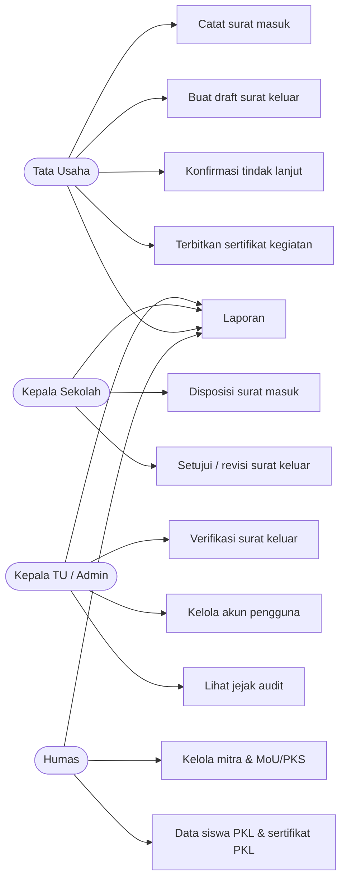

# Use Case, Alur Proses, dan Navigasi

## Alur surat masuk & disposisi
Catat (TU) → menunggu disposisi → Kepsek mengisi disposisi → menunggu konfirmasi TU → TU konfirmasi → selesai.

## Alur surat keluar
Draft (TU) → menunggu verifikasi → Kepala TU: setuju (nomor dibuat) atau revisi → menunggu persetujuan Kepsek → setuju (siap dicetak) atau revisi.

## Status masa berlaku MoU/PKS (otomatis)
Data belum lengkap · Belum berlaku · Berlaku · Segera berakhir (≤ 90 hari) · Kedaluwarsa.

## Struktur navigasi
Ringkasan · Surat masuk · Surat keluar · Laporan · Sertifikat kegiatan · (Humas) Data siswa PKL, Mitra & MoU/PKS · (Admin) Pengguna, Jejak audit.
